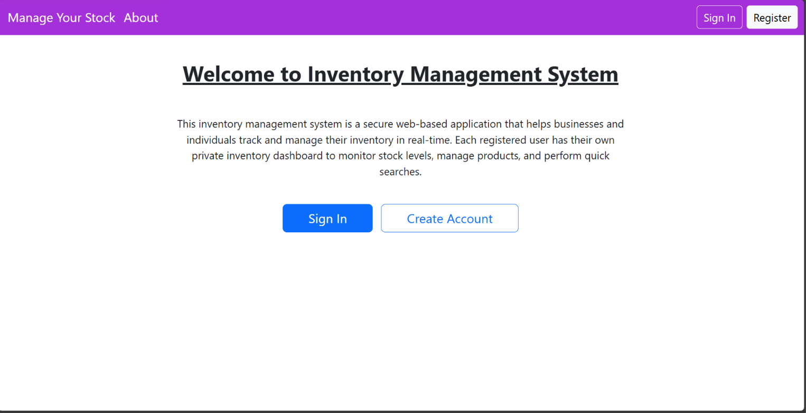
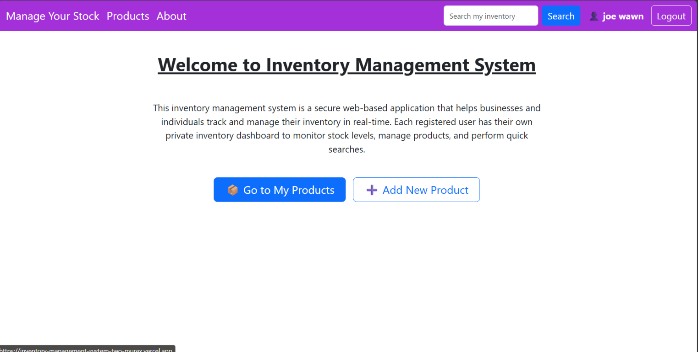
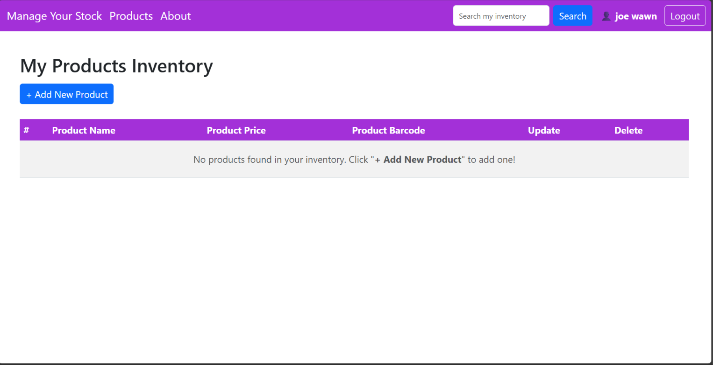
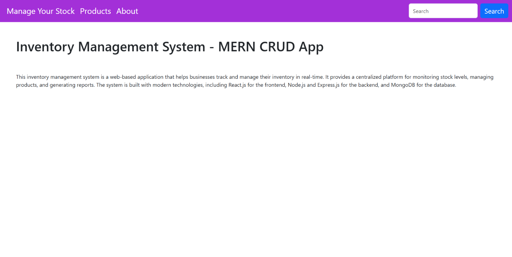

# Inventory Management System

A full-stack **MERN** (MongoDB, Express, React, Node.js) web application for managing personal and business product inventories. Featuring **JWT user authentication**, **per-user inventory isolation**, **real-time product search**, and complete **CRUD operations**, with data persistently hosted in a cloud **MongoDB Atlas** cluster.

| | Link |
|---|---|
| **Live App (Frontend)** | https://inventory-management-system-two-murex.vercel.app/ |
| **Live API (Backend)** | https://inventory-management-system-gyj2.onrender.com |

> **Note**: The backend is hosted on Render's free tier. If the service has been idle, the first request may take ~30–50 seconds while the server spins up.

---

## Screenshots

### Landing Page (logged out)
Visitors see a welcome page with **Sign In** and **Register** options. Inventory pages are only available after logging in.



### Home Page (logged in)
After signing in, the navbar shows the user's name, a **Logout** button and the inventory search bar, with quick links to the user's products.



### Products Inventory
The user's private inventory table with search, **+ Add New Product**, and update/delete controls. A new account starts with an empty inventory, as shown here.



### About Page
Project overview page.



---

## Key Features

- **User Authentication & Authorization**:
  - Secure registration and login powered by **JSON Web Tokens (JWT)**.
  - Password encryption using **bcryptjs** (salt factor 10).
  - Protected client routes and middleware-enforced API security.
- **Per-User Inventory Isolation**:
  - Each registered user has a private inventory dashboard.
  - Strict database-level scoping ensures users can only view, edit, search, and delete their own products.
- **Real-Time Product Search**:
  - Instant search filtering by **Product Name** (case-insensitive regex) and **Product Barcode**.
  - One-click clear search with active query feedback.
- **Full CRUD Management**:
  - **Create**: Add new items with Name, Price, and Barcode.
  - **Read**: View structured inventory tables with automatic empty/loading states.
  - **Update**: Pre-filled editing forms to update existing stock details.
  - **Delete**: Quick item deletion with confirmation.
- **Resilient Architecture**:
  - Offline in-memory fallback support so local development never freezes if cloud connections are blocked.
  - Unified error handling with clear on-screen alerts and loading spinners.
- **Responsive UI**:
  - Built with **Bootstrap 5** and **Font Awesome** for a seamless mobile and desktop experience.

---

## Tech Stack

| Layer | Technology |
|---|---|
| **Frontend** | React 18, React Router v6, Bootstrap 5, Font Awesome, HTML5, CSS3 |
| **Backend** | Node.js, Express.js |
| **Authentication** | JSON Web Tokens (JWT), bcryptjs |
| **Database** | MongoDB Atlas, Mongoose ODM |
| **Hosting** | Vercel (Frontend), Render (Backend), MongoDB Atlas (Database) |

---

## Architecture & Request Flow

```
┌─────────────────┐       HTTPS / JSON       ┌────────────────────────┐       Mongoose       ┌──────────────────────┐
│  React Browser  │ ───────────────────────► │   Express.js API       │ ───────────────────► │   MongoDB Atlas      │
│   (on Vercel)   │ ◄─────────────────────── │   (on Render)          │ ◄─────────────────── │   (Cloud Database)   │
└─────────────────┘                          └────────────────────────┘                      └──────────────────────┘
        │                                                │
   Stores JWT in                                  Verifies JWT via
    localStorage                                  fetchUser middleware
```

1. **Authentication**: The user signs up or logs in. The backend verifies credentials, signs a JWT token, and returns user details. The token is stored in the browser's `localStorage`.
2. **Authorized API Calls**: For any inventory operation, the React app sends an HTTP request with `Authorization: Bearer <token>`.
3. **Middleware Verification**: Express passes the request through `fetchUser` middleware, decoding `req.user.id`.
4. **Data Scoping**: Mongoose queries are strictly filtered by `{ userId: req.user.id }`.
5. **UI Update**: React updates component state and displays the user's isolated inventory.

---

## Project Structure

```
.
├── Backend/
│   ├── index.js                  # Express server entry point & middleware
│   ├── db.js                     # MongoDB Atlas connection & error handlers
│   ├── middleware/
│   │   └── fetchUser.js          # JWT authentication middleware
│   ├── Models/
│   │   ├── Users.js              # User schema (name, email, password, date)
│   │   └── Products.js           # Product schema (userId, name, price, barcode)
│   ├── Routes/
│   │   ├── auth.js               # Auth routes (register, login, getuser)
│   │   └── router.js             # Inventory CRUD & search routes
│   └── package.json
│
├── Frontend/
│   └── inventory_management_system/
│       ├── public/               # Static assets & index.html
│       ├── vercel.json           # SPA rewrites for Vercel
│       └── src/
│           ├── App.js            # Router configuration & routes
│           ├── config.js         # API base URL resolution
│           └── components/
│               ├── Navbar.js     # Responsive nav with auth state & search
│               ├── Home.js       # Welcome landing page
│               ├── Login.js      # Sign-in form
│               ├── Register.js   # Sign-up form
│               ├── Products.js   # Inventory table & live search
│               ├── InsertProduct.js # Add product form
│               ├── UpdateProduct.js # Edit product form
│               └── About.js      # App overview
│
└── screenshots/                  # Documentation images
    ├── home-logged-out.png
    ├── home.png
    ├── products.png
    └── about.png
```

---

## Data Models

### 1. Users Schema (`Backend/Models/Users.js`)
| Field | Type | Description |
|---|---|---|
| `name` | String | User's full name (required) |
| `email` | String | Unique email address (required, lowercase, indexed) |
| `password` | String | Hashed password via bcryptjs (required) |
| `date` | Date | Account creation timestamp (default: `Date.now`) |

### 2. Products Schema (`Backend/Models/Products.js`)
| Field | Type | Description |
|---|---|---|
| `userId` | ObjectId | Reference to `Users` model for ownership |
| `ProductName` | String | Product title / description (required) |
| `ProductPrice` | Number | Unit price (required) |
| `ProductBarcode` | Number | Barcode number (required) |
| `timestamps` | Date | Created / updated timestamps |

---

## API Endpoints

**Base URL**: `https://inventory-management-system-gyj2.onrender.com`

### Authentication Routes
| Method | Endpoint | Auth Required | Description |
|---|---|---|---|
| `POST` | `/auth/register` | No | Register a new user and receive JWT |
| `POST` | `/auth/login` | No | Authenticate user and receive JWT |
| `GET` | `/auth/getuser` | Yes (`Bearer <token>`) | Get logged-in user profile |

### Inventory Routes
| Method | Endpoint | Auth Required | Description |
|---|---|---|---|
| `GET` | `/products` | Yes (`Bearer <token>`) | Get user's products (supports `?search=<term>`) |
| `GET` | `/products/:id` | Yes (`Bearer <token>`) | Get specific product by ID |
| `POST` | `/insertproduct` | Yes (`Bearer <token>`) | Add product to user's inventory |
| `PUT` | `/updateproduct/:id` | Yes (`Bearer <token>`) | Update product owned by user |
| `DELETE`| `/deleteproduct/:id` | Yes (`Bearer <token>`) | Delete product owned by user |
| `GET` | `/search/:key` | Yes (`Bearer <token>`) | Search user's inventory by name or barcode |

---

## Running Locally

### Prerequisites
- [Node.js](https://nodejs.org/) (v16 or higher)
- [npm](https://www.npmjs.com/)
- A free [MongoDB Atlas](https://www.mongodb.com/cloud/atlas) cluster

### 1. Clone the repository
```bash
git clone https://github.com/Afra-create/Inventory-Management-System.git
cd Inventory-Management-System
```

### 2. Backend Setup
```bash
cd Backend
npm install
```

Create a `.env` file in `Backend/`:
```env
Mongo_url=mongodb+srv://<username>:<password>@<cluster>.mongodb.net/IMS?retryWrites=true&w=majority
PORT=3001
JWT_SECRET=your_jwt_secret_key
```

Start the backend:
```bash
npm start
# or with nodemon auto-reload:
npm run server
```
*Backend runs on `http://localhost:3001`.*

### 3. Frontend Setup
In a new terminal:
```bash
cd Frontend/inventory_management_system
npm install
npm start
```
*Frontend runs on `http://localhost:3000`.*

---

## Deployment Configuration

| Component | Platform | Configuration Details |
|---|---|---|
| **Database** | MongoDB Atlas | Cluster created, network access IP whitelisted (`0.0.0.0/0`), user credentials configured. |
| **Backend** | Render | Root Directory: `Backend`<br>Build Command: `npm install`<br>Start Command: `npm start`<br>Environment Variables: `Mongo_url`, `JWT_SECRET`. |
| **Frontend** | Vercel | Root Directory: `Frontend/inventory_management_system`<br>Build Command: `npm run build`<br>Output Directory: `build`<br>Environment Variable: `REACT_APP_API_URL` pointing to Render API. |

---

